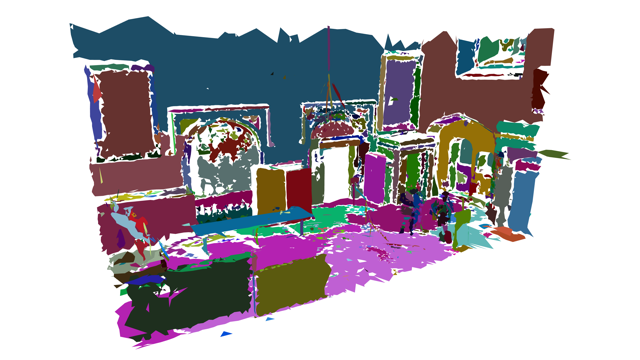
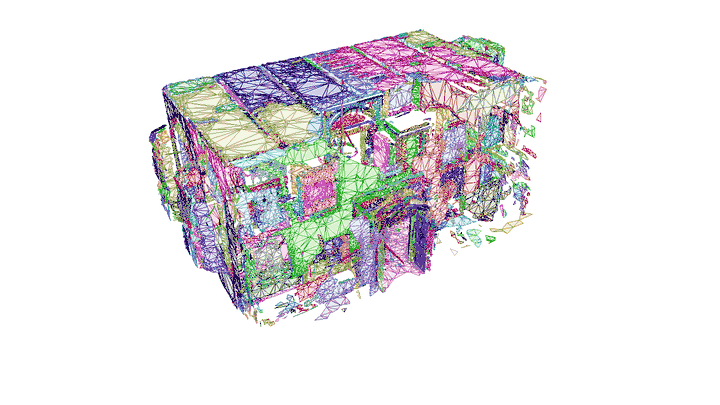

<div align="center">
  <h1>PlanarMesh: Building Compact 3D Meshes from LiDAR using Incremental Adaptive Resolution Reconstruction</h1>
  <b>IEEE/RSJ International Conference on Intelligent Robots and Systems (IROS) 2025</b>
  <p>
    <a href="https://jiahao.wang/" target="_blank">Jiahao Wang</a>,
    <a href="https://ori.ox.ac.uk/people/nived-chebrolu/" target="_blank">Nived Chebrolu</a>,
    <a href="https://yifutao.github.io/" target="_blank">Yifu Tao</a>,
    <a href="https://ori.ox.ac.uk/people/lintong-zhang/" target="_blank">Lintong Zhang</a>,
    <a href="https://ayoungk.github.io/" target="_blank">Ayoung Kim</a>,
    <a href="https://ori.ox.ac.uk/people/maurice-fallon/" target="_blank">Maurice Fallon</a>
  </p>

  [](https://dynamic.robots.ox.ac.uk/pdfs/2025IROS_wang.pdf)
  [](https://arxiv.org/abs/2510.13599)
  [](https://ieeexplore.ieee.org/document/11246204)
  [](https://www.youtube.com/watch?v=GmMR96nYp90)
  [](https://jiahao.wang/planarmesh)

  
</div>

PlanarMesh is a novel, incremental, mesh-based LiDAR reconstruction system. It adaptively adjusts the mesh resolution to create compact and detailed 3D reconstructions in real-time. By combining plane modeling and meshing, it can capture both large, flat surfaces and detailed geometry. The mesh is incrementally updated, considering local surface curvature and free-space information from the LiDAR sensor.

The system uses a multi-threaded architecture with a Bounding Volume Hierarchy (BVH) for efficient data storage and fast search operations, which allows it to achieve real-time performance. Compared to state-of-the-art techniques, PlanarMesh produces **significantly smaller output files** (10× smaller than raw input, >5× smaller than mesh-based methods) while maintaining comparable or superior reconstruction accuracy at **~2 Hz for a 64-beam LiDAR**.

## 🎬 Preview

<div align="center">
  <a href="https://jiahao.wang/planarmesh"></a>
</div>

PlanarMesh wireframe of Christ Church 03 ([Oxford Spires](https://dynamic.robots.ox.ac.uk/datasets/oxford-spires/)); each colour is one planar-mesh. Explore the reconstructed meshes as **interactive 3D models** on the [project page](https://jiahao.wang/planarmesh), or watch the [video](https://www.youtube.com/watch?v=GmMR96nYp90).

## 📦 Dependencies

The project requires the following dependencies to be installed on your system:

*   **C++17** compatible compiler
*   **CMake** (version 3.10 or higher)
*   **Point Cloud Library (PCL)** (version 1.14)
*   **Computational Geometry Algorithms Library (CGAL)**
*   **OpenMP**


## 🔨 Build

1.  Clone the repository:
    ```bash
    git clone https://github.com/ori-drs/planar_mesh.git
    cd planar_mesh
    ```

2.  Create a build directory and navigate into it:
    ```bash
    mkdir build
    cd build
    ```

3.  Run CMake to configure the project and then build it (replace `8` with the number of CPU cores to speed up compilation):
    ```bash
    cmake ..
    make -j8
    ```

4.  The executable will be located in the `build` directory:
    ```bash
    ./main
    ```

## 🚀 Running PlanarMesh

### Dataset Configuration

All configuration, including the path to the dataset, is hardcoded in `src/MeshObject/Settings.cpp`. 

**Default Dataset** By default, the application uses the sample dataset. [Link to video demonstration](https://drive.google.com/file/d/1MKtGLPgHi0fm0rIQSkwBCwgRKYpoOG-N/view?usp=sharing).
1. **Download:** [Get the sample dataset here](https://drive.google.com/file/d/1rLUc6_Em_md6K8rd4fgqMyjkoJQz2Il_/view?usp=drive_link).
2. **Install:** Unzip the contents directly into the PlanarMesh directory.

**Other Dataset** To run the application with your own data, you must modify this file and recompile the project.

1.  **Open the settings file:** `src/MeshObject/Settings.cpp`.
2.  **Add a new dataset entry:** Inside the `Settings::Settings()` constructor, locate the `dataset_map`. Add a new entry with a unique key for your dataset. You need to provide the path to your point cloud file folder (`pcd_file_folder`) and the corresponding pose file (`pose_file_path`).

    ```cpp
    // Example of adding a new dataset
    dataset_map["my_awesome_dataset"] = {
        "/path/to/your/pcd_files/", // pcd_file_folder
        "/path/to/your/pose_file.txt"  // pose_file_path
    };
    ```

3.  **Select your dataset:** Change the value of the `dataset` string variable to the key you just added.

    ```cpp
    // Set the active dataset
    std::string dataset = "my_awesome_dataset";
    ```

4.  **Recompile:** Save the file, navigate to your `build` directory, and run `make`.

### Execution Modes

The application can be run in two modes, controlled by the `headless_mode` boolean in `src/MeshObject/Settings.cpp`.

*   **Display Mode (`headless_mode = false;`):** This is the default mode. It launches an interactive PCL viewer where you can visualize the mesh generation process in real-time and control the application using keyboard commands.
*   **Headless Mode (`headless_mode = true;`):** This mode runs the entire processing pipeline without a GUI. The final mesh is automatically saved to disk upon completion.

### Multithreading

Multithreaded processing can occasionally deadlock, which typically shows up as the PCL visualizer freezing during processing.

It is recommended to use a higher number of threads, as this appears to reduce the likelihood of a deadlock. For context, the benchmarking in the original paper was performed on a machine with 28 cores. The more cores available, the less likely the application is to deadlock. The number of threads can be configured in `src/MeshObject/Settings.cpp`.

## ⌨️ Interactive Viewer Keybindings

When running in display mode, you can use the following keybindings in the PCL viewer window.

### Processing Control

| Key(s)  | Action                            |
| :------ | :-------------------------------- |
| `space` | Process one frame/loop.           |
| `1`     | Process 1 step.                   |
| `2`     | Process 10 steps.                 |
| `3`     | Process 100 steps.                |
| `4`     | Process 1000 steps.               |
| `6`     | Process 10 frames/loops.          |
| `7`     | Process 50 frames/loops.          |
| `8`     | Process 100 frames/loops.         |
| `0`     | Process all remaining data.       |
| `r`     | Restart the processing from the beginning. |

### Display & Toggles

| Key(s)         | Action                                     |
| :------------- | :----------------------------------------- |
| `Return`       | Force an update of the display.            |
| `,` (comma)    | Toggle visibility of vertices (point cloud). |
| `.` (period)   | Toggle visibility of boundary edges.       |
| `/` (slash)    | Toggle visibility of mesh triangles.       |
| `l`            | Toggle visibility of interior points.      |
| `;` (semicolon)| Toggle visibility of internal vertices.    |
| `v`            | Toggle wireframe rendering.                |
| `a`            | Cycle through point display modes (Used, Original, Projected). |
| `numpad 9`     | Toggle visibility of the seed surface.     |
| `Tab`          | Trigger a color change.                    |

### Color Modes (Numpad)

| Key(s)         | Action                                     |
| :------------- | :----------------------------------------- |
| `numpad 0`     | Color by object ID.                        |
| `numpad 1`     | Color by positional uncertainty.           |
| `numpad 2`     | Color by normalized positional uncertainty.|
| `numpad 3`     | Color by radius.                           |
| `numpad 4`     | Color by surface uncertainty.              |
| `numpad 5`     | Color by max distance travelled.           |
| `numpad 6`     | Color by distance travelled.               |
| `numpad 7`     | Color by projected uncertainty.            |
| `numpad 8`     | Color by weight.                           |

### Mesh Operations

| Key(s)         | Action                          |
| :------------- | :------------------------------ |
| `n`            | Remove non-manifold edges.      |
| `m`            | Remove non-manifold vertices.   |
| `k`            | Remove non-manifold faces.      |

### Exporting

| Key(s)         | Action                                       |
| :------------- | :------------------------------------------- |
| `9`            | Export current view components to PLY files. |
| `b`            | Generate and save a simplified mesh (`simplified.ply`). |

### Debugging

| Key(s)         | Action                                       |
| :------------- | :------------------------------------------- |
| `Num Lock`     | Toggle display of keycodes in the console.   |


## ⚙️ Configuration

The `src/MeshObject/Settings.cpp` file contains numerous other parameters for controlling the meshing algorithm, visualization options, and logging behavior. You can modify these values before compilation to experiment with different configurations. The corresponding `include/MeshObject/Settings.hpp` header file provides a reference for all available settings.

## 🚧 Code Status

Please be aware that not all of the code in this repository is actively used by the final application. The codebase contains some legacy and development code that was part of earlier experiments and was subsequently abandoned.


## 📄 License

This project is released under the [GNU GPL v3.0](./LICENSE.txt).


## 📚 Citation

If you find PlanarMesh useful for your research, please consider citing:

```bibtex
@inproceedings{wang2025planarmesh,
  title={{PlanarMesh}: Building Compact {3D} Meshes from {LiDAR} using Incremental Adaptive Resolution Reconstruction},
  author={Wang, Jiahao and Chebrolu, Nived and Tao, Yifu and Zhang, Lintong and Kim, Ayoung and Fallon, Maurice},
  booktitle={IEEE/RSJ Intl. Conf. on Intelligent Robots and Systems (IROS)},
  year={2025}
}
```
